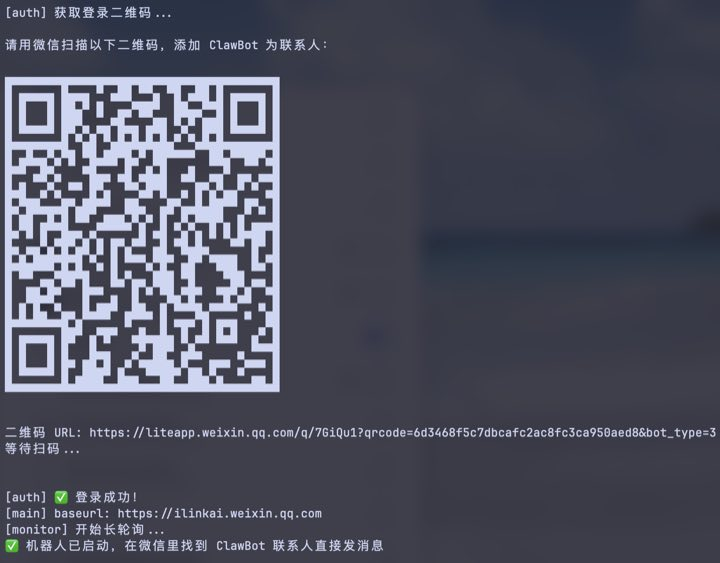
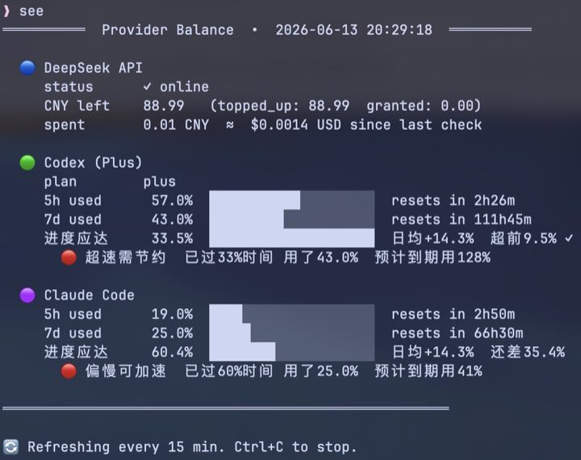
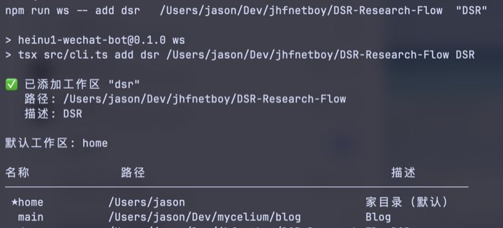
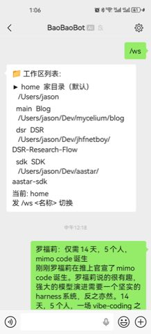
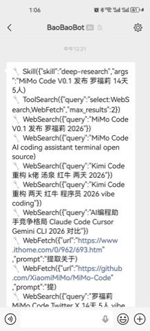
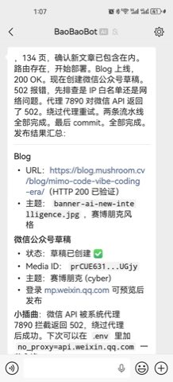

# 黑奴一号 · Heinu1

<p align="center">
  
  
  
  
  
  
  
  
</p>

<p align="center">
  <b>用微信远程控制家里笔记本上的 Codex，随时随地让 AI 帮你干活。</b><br/>
  <i>Control your home laptop's Codex from WeChat, anywhere, anytime.</i>
</p>

---

## 它能做什么

在微信里给 **ClawBot** 发一条消息，家里的笔记本就开始干活：

| 你说什么 | Codex 做什么 |
|---|---|
| 帮我把 vlog 脚本和公众号文章合并，发布到博客 | 读文件 → 合并 → 写博客 → git push → 回复"发布成功" |
| 研究一下 MiMo Code 发布，写一篇分析 | 联网搜索 → 整合资料 → 写文章 → 保存到工作区 |
| 现在在做什么进展怎样 | 汇报当前任务状态 |
| [转发一个小红书/公众号链接] | 抓正文 → 总结 → 自动存进全局知识库，`/kb search` 随时能翻出来 |
| /ws main | 切换到主项目目录开始工作 |

> **关键特性**：Bot 收到消息立刻回复"收到，开始执行"，你知道它在干活不是死机了。

---

## 截图

<table>
<tr>
<td align="center" width="50%">

<br/><sub><b>首次启动：扫码登录</b></sub>
</td>
<td align="center" width="50%">

<br/><sub><b>多平台 API 余额与用量监控（<code>see</code> 命令）</b></sub>
</td>
</tr>
<tr>
<td align="center" width="50%">

<br/><sub><b>命令行添加工作区目录</b></sub>
</td>
<td align="center" width="50%">

<br/><sub><b>查看所有工作区配置</b></sub>
</td>
</tr>
<tr>
<td align="center" width="33%">

<br/><sub><b>微信里 /ws 切换工作区</b></sub>
</td>
<td align="center" width="33%">

<br/><sub><b>调用工具执行任务（历史 Claude 截图）</b></sub>
</td>
<td align="center" width="33%">

<br/><sub><b>任务完成：博客发布成功 + 公众号草稿已创建</b></sub>
</td>
</tr>
</table>

> 📖 案例：[用黑奴一号发布 MiMo Code 新闻的结果](https://blog.mushroom.cv/blog/mimo-code-vibe-coding-era/)（博客发布 + 公众号草稿，一条微信消息搞定）

---

## 快速开始

### 前置要求

| 要求 | 验证方式 |
|---|---|
| macOS（用 launchd 自动重启） | — |
| Node.js 18+ | `node -v` |
| Codex 已安装并登录 | `codex --version` / `codex login status` |
| 微信版本 ≥ 2026.3.20（支持 iLink Bot） | 微信 → 关于微信 |

### 第一步：安装

```bash
git clone https://github.com/jhfnetboy/Heinu1.git
cd Heinu1/bot
bash setup.sh          # npm install + 注册开机自启服务
```

### 第二步：配置工作区（在电脑上做一次）

告诉 Bot 你的项目在哪，第一个自动成为默认：

```bash
npm run ws -- add main   ~/Dev/myproject    "主项目"
npm run ws -- add blog   ~/Dev/blog         "博客"
npm run ws -- add tools  ~/Dev/tools        "工具脚本"

npm run ws -- list    # 确认配置正确（★ 是默认）
```

### 第三步：启动

```bash
npm start
```

终端里会出现二维码：

```
请用微信扫描以下二维码，添加 ClawBot 为联系人：
[二维码图案]
✅ 机器人已启动，在微信里找到 ClawBot 联系人直接发消息
```

用微信扫码，添加 **ClawBot** 为联系人，完成。

之后按这台机器的定位选运行模式：

```bash
./ctl.sh autostart on    # 常驻服务器：开机自启 + 崩溃自动拉起（推荐 Mac mini）
./ctl.sh autostart off   # 办公电脑：不常驻，用 ./ctl.sh start / stop 手动控制
```

> 要把机器人挪到一台 Mac mini 上 7×24 跑，照 **[docs/DEPLOY-MACMINI.md](docs/DEPLOY-MACMINI.md)**
> 一步步来（含防睡眠、自动登录、断电自启、旧机器迁移）。

---

## 微信使用指南

### 发任务

直接发消息描述你要做什么，Bot 立刻回复确认，完成后发结果：

```
你：帮我把 dev-log.md 整理成一篇博客发布到 /blog 目录，然后 git push

⚡ 收到，开始执行
📁 工作区: blog
📝 帮我把 dev-log.md 整理成一篇博…

（Codex 读文件、写博客、执行 git push...）

🔧 command_execution · file_change

已完成：将 dev-log.md 整理为博客文章 2026-06-11-dev-log.md，
共 847 字，已 git push 到远程。
```

### 切换工作区

```
/ws              → 列出所有工作区（▶ 标当前）
/ws main         → 切换到 main，续接上次对话
/ws blog         → 切换到 blog 目录
```

切换后 Codex 的工作目录和对话上下文**同时切换**。

### 管理会话

```
/sessions        → 当前工作区历史会话列表
/resume 2        → 切换到第 2 个历史会话
/new             → 开启全新会话（清空上下文）
/status          → 查看当前工作区 + 会话状态
/help            → 完整命令帮助
```

### 全部命令速查

| 命令 | 说明 |
|---|---|
| `/ws` | 列出所有工作区 |
| `/ws <名称>` | 切换工作区 |
| `/ws add <名称> <路径> <描述>` | 添加工作区（微信里加，不推荐；用命令行更方便） |
| `/ws rm <名称>` | 删除工作区 |
| `/ws default <名称>` | 设为默认工作区 |
| `/new` | 开启新会话 |
| `/sessions` | 查看本工作区会话历史 |
| `/resume <n>` | 恢复第 n 个会话 |
| `/status` | 查看当前状态 |
| `/kb` | 最近入库的知识库记录 |
| `/kb <编号>` | 查看某条记录详情 |
| `/kb search <关键词>` | 搜索知识库 |
| `/retry` | 重试上次失败的任务 |
| `/stop` | 中止当前任务 |
| `/help` | 帮助 |

---

## 知识库（全局 MemPalace）

发给 Bot 的**图片、文件、视频，或者带链接的消息**，处理完会自动整理成一条知识库记录 —— 不用额外说"帮我存起来"。纯聊天文字不入库，避免闲聊污染知识库。

```
你：[转发一篇公众号文章链接]
Bot：（抓取正文 → 总结 → 回复）
     📥 已入库 #7 《...》
```

链接会先用 `libs/agent-reach` 抓正文（小红书 / 公众号 / 普通网页），再连同总结一起入库。

**存在哪：** 全局 MemPalace —— `~/.mempalace/palace`（wing 为 `heinu1`），供这台机器上的 coding agent 会话共用，不是 Bot 私有的小 SQLite。原始图片文件仍按日期归档在 `~/.heinu1-bot/kb/raw/`。

**依赖：** 需要本机装好 MemPalace，默认走 `~/.mempalace/venv/bin/python`。venv 在别处就设环境变量：

```bash
export MEMPALACE_PYTHON=/path/to/venv/bin/python
```

没装 MemPalace 也不影响聊天和跑任务，只是入库会失败。

> `/kb` 和 `/kb search` 列出的编号在同一个 Bot 进程内是稳定的（同一条记录在两处拿到同一个号），但重启后会重新分配 —— 隔天再查详情，先发 `/kb` 或重新搜一次拿最新编号。

---

## 工作区 CLI（命令行管理）

在电脑终端操作比在微信里更方便：

```bash
npm run ws -- list                           # 查看所有工作区
npm run ws -- add <名称> <路径> [描述]        # 添加
npm run ws -- rm  <名称>                     # 删除
npm run ws -- default <名称>                 # 改默认
npm run ws -- show                           # 查看配置文件原始内容
```

配置写入 `~/.heinu1-bot/workspaces.json`，Bot 重启后自动生效。

---

## 日常运维

所有启停都走 `bot/ctl.sh`，一个脚本管到底：

```bash
cd bot

./ctl.sh start          # 后台启动
./ctl.sh stop           # 停止
./ctl.sh restart        # 重启
./ctl.sh status         # 状态（进程 + 开机自启 + 最近日志）
./ctl.sh logs           # 实时日志
./ctl.sh fg             # 前台启动（首次扫码登录用，Ctrl-C 退出）

./ctl.sh autostart on       # 开启开机自启 + 常驻保活（launchd）
./ctl.sh autostart off      # 关闭开机自启（进程一并退出）
./ctl.sh autostart status   # 查看开机自启开关
```

```bash
npm run relogin         # 清除 token，重新扫码
```

> **两种运行模式，按机器选一种：**
>
> | 机器 | 模式 | 怎么做 |
> |---|---|---|
> | 常驻服务器（Mac mini） | 24 小时在线、开机自启、崩了自动拉起 | `./ctl.sh autostart on` |
> | 日常办公电脑 | 想跑才跑，不占后台 | `./ctl.sh autostart off`，之后 `./ctl.sh start` / `stop` |
>
> **同一时间只能有一台机器在线**——ClawBot 的 token 绑在微信账号上，两台同时长轮询会互相抢消息。
> 完整的 Mac mini 常驻部署手册见 **[docs/DEPLOY-MACMINI.md](docs/DEPLOY-MACMINI.md)**。

---

## 执行后端与权限

默认 `AGENT_PROVIDER=codex`，调用本机已登录的 Codex。部署模板使用 `gpt-6-luna`、`medium`；`CODEX_MODEL` 未设置的手动运行仍继承本机模型。设置只覆盖机器人任务。

在 `bot/launchd/com.heinu1.wechat-bot.plist` 模板或已安装的 `~/Library/LaunchAgents/com.heinu1.wechat-bot.plist` 调整，已安装服务需要 `./ctl.sh autostart off` 再 `./ctl.sh autostart on` 重载。

| 配置 | 默认值 | 说明 |
|---|---|---|
| `AGENT_PROVIDER` | `codex` | 可设 `claude` 回退到原后端 |
| `CODEX_BIN` | `codex` | CLI 路径 |
| `CODEX_MODEL` | 部署模板 `gpt-6-luna` | 未设置时继承本机模型 |
| `CODEX_REASONING_EFFORT` | `medium` | Codex 推理强度 |
| `CODEX_SANDBOX_MODE` | `danger-full-access` | 延续机主全自动执行权限；也支持 `workspace-write`、`read-only` |

Codex 无人值守任务使用 `approval_policy=never`。Claude 回退仍支持 `CLAUDE_BIN`、`CLAUDE_MODEL` 和 `CLAUDE_PERMISSION_MODE`。

旧 Claude 会话保留在数据库，按后端隔离。切到 Codex 后首次任务开启新会话，`/sessions` 和 `/resume` 只查看当前后端的历史。

微信里显式切换，无需重启服务：

```text
/backend              查看当前后端
/backend claude       改用 Claude Code
/backend codex        改回 Codex
/model auto           日常 Luna Medium；研究/三件套自动 Sol Medium
/model luna medium    手动固定 GPT-6 Luna，medium
/model terra medium   Codex 改用 GPT-5.6 Terra，medium
/model sol medium     Codex 改用 GPT-6.1 Sol，medium
/status               查看当前后端、模型、强度与工作区
```

选择按微信用户存 SQLite，重启后保留。切换后端会续接它自己的历史；模型切换继续当前 Codex 对话。任务执行、消息收集或队列未清空时会拒绝切换，先等完成或 `/stop`。Codex 额度不足时提示手动切换，避免自动重跑发布任务。Claude 也需要有效登录和剩余额度。


---

## 工作原理

```text
微信 → iLink 官方 API → Monitor → Router → runAgent
                                         ↓
                              codex exec --json -
                              cwd = 当前工作区
                              prompt = stdin
                                         ↓
                         thread.started / item.* / turn.completed
                                         ↓
                         SQLite 保存 thread ID → Sender 回复微信
```

每轮任务启动一个 CLI 进程，连续对话通过 `codex exec resume <thread-id> -` 恢复。SQLite 按用户、工作区和后端记录会话，真实对话由对应 CLI 持久化。工作区的 `AGENTS.md` 和 skills 指导 Codex 执行文章发布等任务。

---

## 项目结构

```
Heinu1/
├── bot/
│   ├── src/
│   │   ├── main.ts          ← 入口
│   │   ├── cli.ts           ← 工作区配置 CLI（npm run ws）
│   │   ├── config.ts        ← 路径、环境变量
│   │   ├── router.ts        ← 命令解析 + 任务调度
│   │   ├── workspace.ts     ← 工作区加载/保存/切换
│   │   ├── ilink/
│   │   │   ├── auth.ts      ← QR 登录，token 持久化
│   │   │   ├── client.ts    ← iLink HTTP 客户端（native fetch）
│   │   │   ├── monitor.ts   ← 长轮询消息接收
│   │   │   ├── sender.ts    ← 发送消息（含分片 1800 字）
│   │   │   └── types.ts     ← iLink 协议类型
│   │   ├── agent/runner.ts  ← 后端分发与通用事件
│   │   ├── codex/runner.ts  ← Codex exec / resume JSONL
│   │   ├── claude/
│   │   │   ├── runner.ts    ← 可选 Claude 后端，解析 stream-json
│   │   │   └── store.ts     ← SQLite 会话管理
│   │   └── kb/
│   │       ├── ingest.ts          ← 入库指令拼装 + kb-record 解析 + 原始文件归档
│   │       └── mempalace-store.ts ← 知识库读写（转发给 mp_bridge.py）
│   ├── scripts/
│   │   └── mp_bridge.py     ← 全局 MemPalace 的 JSON 桥（Python）
│   ├── launchd/             ← macOS 开机自启配置
│   ├── start.sh             ← launchd 启动包装（处理 PATH/nvm）
│   └── setup.sh             ← 一键安装脚本
├── docs/
│   ├── images/              ← README 截图
│   ├── sdk-vs-cli-analysis.md
│   └── wechat-bot-research.md
└── libs/                    ← 参考库（git submodule，只读）
```

---

## 常见问题

**Q：发消息后没动静怎么办？**
Bot 收到消息会立刻回复"⚡ 收到，开始执行"。如果没收到，说明 Bot 可能没在运行，运行 `launchctl list | grep heinu1` 检查，或 `npm run logs` 看日志。

**Q：Session 过期怎么办？**
Bot 进程会自动退出，launchd 自动重启并弹出二维码，重新扫码即可。

**Q：能不能多人使用？**
可以。iLink Bot 支持多用户，每个用户有独立的会话和工作区状态（内存中，重启后回到默认工作区）。

**Q：`channel_version` / iLink 协议相关的坑？**
见 [docs/wechat-bot-research.md](docs/wechat-bot-research.md)。

---

## 技术细节

### Codex 是怎么被调用的

```bash
# 新会话，提示词通过 stdin 传入
codex exec --json --skip-git-repo-check \
  -c 'approval_policy="never"' -c 'sandbox_mode="danger-full-access"' -

# 连续对话，同样通过 stdin 传入新消息
codex exec --json --skip-git-repo-check \
  -c 'approval_policy="never"' -c 'sandbox_mode="danger-full-access"' \
  resume <thread-id> -
```

`thread.started` 提供会话 ID，工具条目形成工具摘要，`turn.completed` 后取最终 `agent_message` 回复微信。失败或缺少完成事件时提示错误；丢失的会话只在尚未执行工具前自动开启新会话，防止重复发布。`/stop` 会终止 Codex 及其命令子进程。

验证（在 `bot/`）：

```bash
npm test              # 会话迁移、JSONL、恢复、失败、中止
npx tsc --noEmit       # TypeScript 检查
npm run smoke:codex    # 真实 CLI 的工具执行、文件写入与会话恢复；不发送微信
```

### iLink 协议真实 API 路径（已验证）

所有端点都在 `/ilink/bot/` 前缀下（缺这个前缀会返回 HTTP 404）：

```bash
# 获取登录二维码
GET  https://ilinkai.weixin.qq.com/ilink/bot/get_bot_qrcode?bot_type=3
# → { qrcode: "轮询用的key", qrcode_img_content: "显示用的URL" }

# 轮询扫码状态（注意：'scaned' 单 n，非 'scanned'）
GET  https://ilinkai.weixin.qq.com/ilink/bot/get_qrcode_status?qrcode=<key>
# Header 需加: iLink-App-ClientVersion: 1（仅此接口需要）
# → { status: "wait|scaned|confirmed|expired", bot_token?, baseurl? }

# 长轮询接收消息（服务端 hold 35秒，有消息才返回）
POST https://ilinkai.weixin.qq.com/ilink/bot/getupdates
Body: { "get_updates_buf": "<cursor>", "base_info": { "channel_version": "1.0.0" } }
# → { msgs: [{from_user_id, context_token, item_list:[{type:1,text_item:{text}}]}], get_updates_buf }

# 发送消息
POST https://ilinkai.weixin.qq.com/ilink/bot/sendmessage
Body: {
  "msg": {
    "to_user_id": "...", "context_token": "...",
    "message_type": 2, "message_state": 2,
    "client_id": "<uuid>",
    "item_list": [{ "type": 1, "text_item": { "text": "回复内容" } }]
  },
  "base_info": { "channel_version": "1.0.0" }
}
```

**协议踩坑记录：**
- 登录成功后服务器可能返回不同的 `baseurl`，后续请求必须用它，不能用默认域名
- `iLink-App-ClientVersion: 1` 只在 `get_qrcode_status` 时加，其他请求不加
- `channel_version` 是 `"1.0.0"` 不是 `"1.0.2"`
- MessageItemType 枚举：TEXT=1, IMAGE=2, VOICE=3, FILE=4, VIDEO=5（不要凭直觉猜）
- 详细协议分析见 [docs/wechat-bot-research.md](docs/wechat-bot-research.md)

### 数据持久化

```
~/.heinu1-bot/
├── token.json          ← iLink bot_token + baseurl（mode 600）
├── workspaces.json     ← 工作区配置
├── sessions.db         ← SQLite，会话记录（user × workspace × provider 维度）
├── media/              ← 微信 CDN 下载并解密后的图片/文件/视频
└── kb/raw/             ← 入库记录的原始文件，按日期归档

~/.mempalace/palace     ← 知识库记录本体（全局 MemPalace，跨项目共享）
```

会话表结构：`(user_openid, workspace, provider, session_uuid, title, created_at, last_used)`。切换工作区时 bot 自动加载该工作区最近一次的 `session_uuid` 用于对应后端的会话恢复。

知识库记录不落在 `~/.heinu1-bot/` 里，而是通过 `bot/scripts/mp_bridge.py` 写进全局 MemPalace，Bot 侧只留原始文件。


### 默认三件套与失败恢复

内容消息（包括纯文字、语音和素材链接）默认先查重，再存 KB，接着完成双语文章、匹配主题的 banner、Blog 上线和公众号草稿。控制命令、日常状态查询及明确不发布的请求按原意处理。

默认自动路由：日常 Luna Medium；复杂研究或三件套在开始执行前自动用 Sol Medium。`/model auto` 恢复自动路由，显式指定模型则固定使用该模型。后端仍通过 `/backend` 手动切换。

失败任务的完整素材与执行状态存 SQLite；重启后恢复，自动最多尝试三次，额度/登录失败延后重试。每次恢复先核对旧记录，只补未完成环节。`/jobs` 查看失败，`/retry all` 重试自己的失败任务，`/stop` 取消当前任务。只在 KB、banner、Blog URL 和公众号 media ID 均核验后报告完成。
